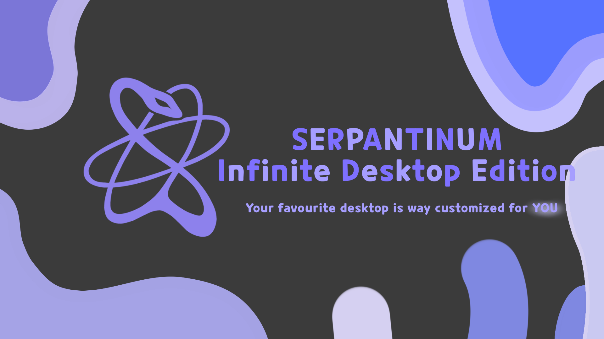
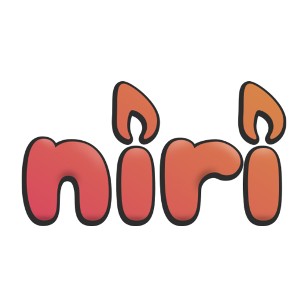
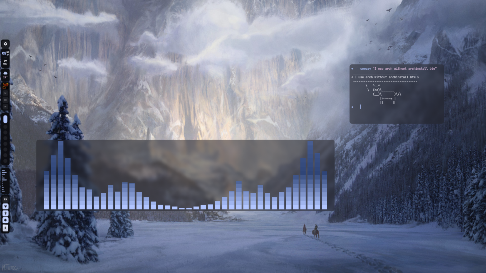
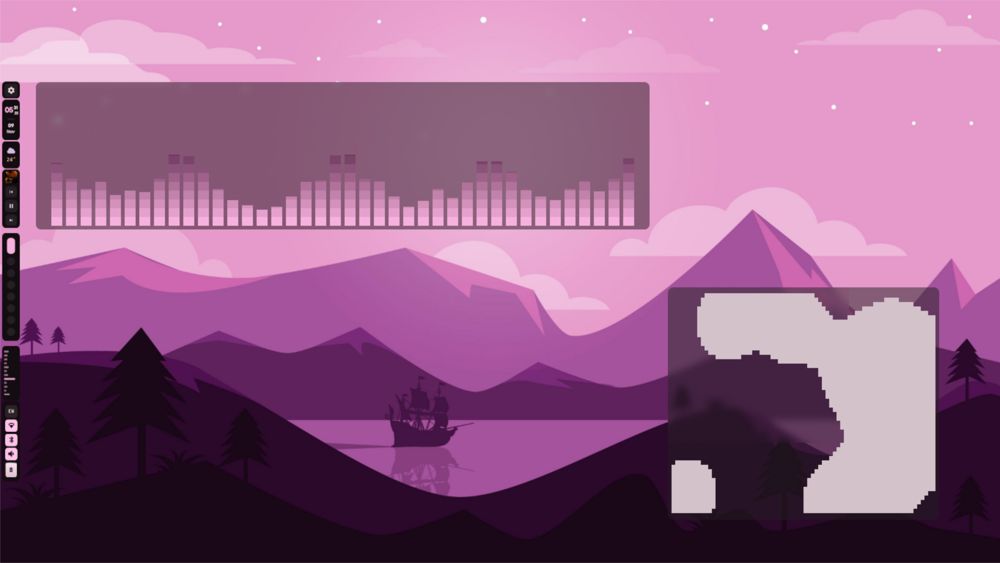
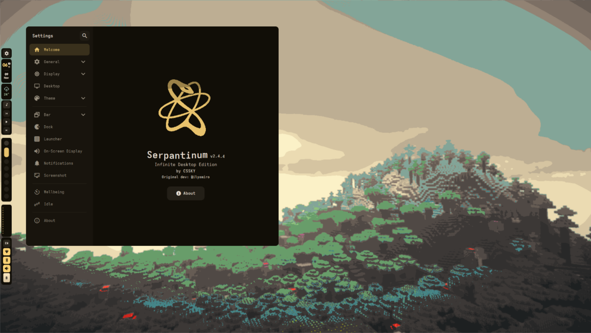
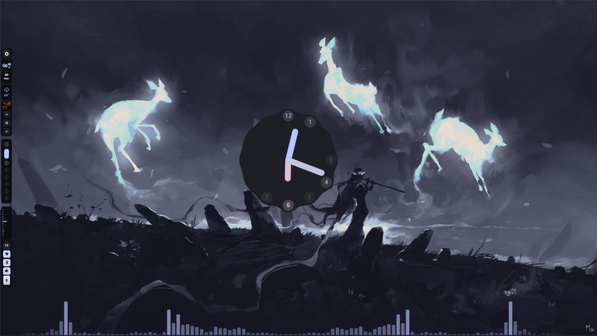

<div align="center">
  

  <h3>Your favourite desktop, customized for <i>you</i>.</h3>

  <p>
    A Wayland shell built on <a href="https://quickshell.org">Quickshell</a>, based on ilyamiro's
    <a href="https://github.com/ilyamiro/serpantinum">Serpantinum</a>,<br />
    with an endless, zoomable desktop for <b>Hyprland</b> and <b>Sway</b>.
  </p>

  <p>
    
    
    
  </p>

  <p>
    &nbsp;&nbsp;
    &nbsp;&nbsp;
    &nbsp;&nbsp;
    &nbsp;&nbsp;
    
  </p>

  <p>
    <a href="#-installation"><b>Install</b></a> &nbsp;•&nbsp;
    <a href="#-infinite-desktop"><b>Infinite desktop</b></a> &nbsp;•&nbsp;
    <a href="#-supported-compositors"><b>Compositors</b></a> &nbsp;•&nbsp;
    <a href="#-running"><b>Running</b></a> &nbsp;•&nbsp;
    <a href="#-cli"><b>CLI</b></a> &nbsp;•&nbsp;
    <a href="./CHANGELOG.md"><b>Changelog</b></a>
  </p>
</div>

> [!NOTE]
> Serpantinum Infinite Desktop Edition is a Wayland desktop shell built on Quickshell and based on ilyamiro's Serpantinum. The infinite desktop supports Hyprland and Sway.

> [!WARNING]
> **Vibecoded with Claude.** Don't trust the AI slop you see on social media about this project. Check this README and the docs instead.

## ✨ At a glance

| | |
| :-- | :-- |
| 🌌 **Infinite desktop** | One large canvas per workspace with animated pan, zoom, marks, tidy and overview |
| 🧩 **Widget redactor** | Many widget styles, including Iridium variants and a Reminder widget |
| 🪟 **Full shell** | Bar, dock, launcher, clipboard, notifications, system panel, calendar, media, network and volume |
| 🔒 **Lockscreen** | Selectable animations and clock styles |
| ⚙️ **Guide settings** | A panel or a standalone window, with a Desktop tab for infinite desktop options |
| 🎨 **Theming** | Colors from your wallpaper, plus [app theming](./docs/configure/AppTheming.md) for GTK, Qt, terminals and editors |
| 🪶 **Light on memory** | Settings tabs and panels are created on demand and released when idle |

## 🖼️ Previews

| | |
|---|---|
|  |  |
|  |  |

---

## 📦 Installation

> [!TIP]
> Full installation and configuration instructions live in the [docs](./docs/Overview.md).

> [!IMPORTANT]
> **Migrating from v1:** All previous configuration will be backed up and unused. Configuration of compositor settings such as monitors, keybinds, and autostart is now up to you, as the project migrated from being dotfiles to being a shell.

### Arch Linux, Fedora, Void Linux and their derivatives

For Arch-based distributions (including systemd, OpenRC, and other init systems), for Fedora-based distributions such as Nobara and Ultramarine, and for Void Linux (glibc and musl), run the automated installation script. It detects your distribution and uses `pacman`, `dnf` or `xbps`.

Use this installer:

```bash
curl -fsSL https://raw.githubusercontent.com/cssky-dev/Serpantinum-Infinite-Desktop-Edition/main/install/get.sh | bash
```

If this doesn't work, use:

```bash
bash -c "$(curl -fsSL https://raw.githubusercontent.com/cssky-dev/Serpantinum-Infinite-Desktop-Edition/main/install/install.sh)"
```

> [!NOTE]
> To update, when or if you receive a notification about the new version being available, just run the script again and choose "update".

More detail, including Fedora, Void and Arch source builds, is in the [installation docs](./docs/installation/installation.md).

---

### NixOS

See the [NixOS installation guide](./docs/installation/nixos/flake.md) for flake setup, the NixOS and Home Manager modules, and updating.

---

## 🔊 Audio engine

The equalizer, balance, mono, channel swap, dynamic range modes and the dynamic EQ run on [serpantinum-audio](https://github.com/ilyamiro/serpantinum-audio), a small PipeWire processor that replaces EasyEffects. The installer and the packages install it, and on the first start after updating, Serpantinum hands your audio over from EasyEffects.

---

## 🧭 Supported compositors

Hyprland, Niri, Sway and Mango. The installer detects the running compositor and deploys its configuration. On Fedora, Mango is installed from the Terra repository. On Void Linux, Hyprland is installed from the third-party black-hole.dev repository.

| Compositor | Shell | Infinite desktop | Config |
| --- | :---: | :---: | --- |
| Hyprland | ✅ | ✅ | [guide](./docs/configure/compositors/hyprland.md) |
| Sway | ✅ | ✅ | [guide](./docs/configure/compositors/sway.md) |
| Niri | ✅ | ❌ | [guide](./docs/configure/compositors/niri.md) |
| Mango | ✅ | ❌ | [guide](./docs/configure/compositors/mango.md) |

---

## 🚀 Running

To run the shell, launch `serpantinumd start`

```bash
serpantinumd start             # start the shell daemon
serpantinum settings           # open settings
serpantinum msg toggle launcher
serpantinum restart            # restart the shell
```

Serpantinum is only a desktop shell. It does not manage your keybinds or monitors, so add the keybinds you want from the [compositor guides](#supported-compositors). The configs in [`compositors/hyprland`](./compositors/hyprland) and [`compositors/sway`](./compositors/sway) already include every infinite desktop bind.

For configuration, see the [configuration guide](./docs/configure/Configure.md).

---

## 🌌 Infinite desktop

Windows and widgets sit on one large canvas per workspace instead of a fixed screen. Pan, zoom, jump to marks, tidy everything up or fit it all into view.

- `Super + G` switches between **Tiled** and **Infinite desktop** mode.
- Each mode keeps its **own widget layout**: `layout.json` for Tiled and `layout-canvas.json` for Infinite desktop, stored per monitor in `~/.local/state/serpantinum/widgets/<monitor>/`.
- Each workspace restores its saved view when you return to it.
- A newly opened app can center the desktop on itself (toggle **Apps switcher when opens** in Settings > Desktop).
- Two zoom methods: resize every app and terminal, or sarods2d-style zoom.

### Keybinds (Hyprland and Sway)

| Keys | Action |
| --- | --- |
| `Super + G` | Toggle Tiled / Infinite desktop |
| `Super + Arrows` | Move focus between windows (the camera follows) |
| `Super + Tab` | Overview (fit all windows) |
| `Super + Home` | Go home |
| `Super + Shift + T` | Tidy windows |
| `Super + =` / `Super + -` | Zoom in / out |
| `Super + Backspace` | Reset zoom (Hyprland) |
| `Super + Shift + Backspace` | Reset zoom (Sway, where `Super + Backspace` is the scratchpad) |
| `Super + Scroll` | Zoom in / out |
| `Super + Ctrl + Scroll` | Pan vertically |
| `Super + Ctrl + Shift + Scroll` | Pan horizontally |
| `Super + Page Up / Down` | Pan one page up / down |
| `Super + Alt + Left / Right` | Pan one page left / right |
| `Super + Alt + 1..9` | Jump to mark |
| `Super + Alt + Shift + 1..9` | Save mark |
| `Super + Left mouse` / `Right mouse` | Drag / resize a window |

On Sway, workspaces move to `Super + Alt + Up / Down` so the arrow keys can drive the canvas.

### How it works on Sway

Hyprland is driven natively. Sway is driven through its IPC: [`src/scripts/canvas/sway.py`](./src/scripts/canvas/sway.py) translates Sway's outputs and window tree for the canvas engine, windows are placed with `swaymsg`, and a single `swaymsg -t subscribe` stream keeps the canvas in sync.

Things to know on Sway:

- Needs `python3` and `swaymsg` (both installed with the shell and Sway).
- Sway cannot report the pointer position, so zoom is anchored to the centre of the focused output.
- Sway hands a floating window to the neighbouring output when its centre leaves its own output, so the infinite desktop works best with one canvas monitor.
- Blur, liquid glass and app move speed tweaks are Hyprland-only and are skipped on Sway.

---

## 🧩 Widgets

Open the widget redactor from the Widgets tab in guide settings, or with `serpantinum redactor`.

- Widgets are saved separately for Tiled and Infinite desktop.
- **Delete all widgets** (Settings > Widgets) clears every widget from both modes on every workspace and screen with a single click.
- Layouts live in `~/.local/state/serpantinum/widgets/`.

## ⚙️ Settings

```bash
serpantinum settings           # open settings
serpantinum settings theme     # open a specific tab
```

In Settings > General, **Standalone Window** opens settings as its own window instead of the panel. In panel mode, drag the settings panel by its header (the "Settings" title) to move it anywhere on the screen. It keeps its position while the infinite desktop moves.

### Memory use

Guide settings tabs and cached panels (settings, wallpaper picker, system panel) are created when you open them. Settings tabs are released 20 seconds after you close settings, and idle panels are released after about 45 seconds. The first open after that takes a moment longer, and search in settings loads all tabs the first time you use it.

## 💻 CLI

```bash
serpantinum canvas toggle          # Tiled <-> Infinite desktop
serpantinum canvas overview        # fit all windows
serpantinum canvas zoomIn
serpantinum canvas panBy 0 160
serpantinum canvas markSet 1       # save a mark
serpantinum canvas markGo 1        # jump to a mark
serpantinum canvas status
```

Other canvas actions: `enable`, `disable`, `focus <dir>`, `fit`, `zoom <factor>`, `zoomOut`, `zoomReset`, `panPage`, `home`, `tidy`, `arrange <mode>`, `dump`.

Full command list: [client docs](./docs/cli/client.md) and [daemon docs](./docs/cli/daemon.md).

---

## 🗂️ Repository layout

<details>
<summary><b>Where things live</b></summary>

| Path | Contents |
| --- | --- |
| `bin/` | `serpantinum` client and `serpantinumd` daemon |
| `src/quickshell/` | Shell UI (QML); `canvas/` holds the infinite desktop |
| `src/scripts/` | Helper scripts; `canvas/sway.py` is the Sway backend |
| `compositors/` | Hyprland, Niri, Sway and Mango configs |
| `install/` | Installer and tests |
| `nix/`, `flake.nix` | Nix packages and modules |
| `packaging/` | AUR PKGBUILDs |
| `docs/` | Documentation |

</details>

## 🛠️ Troubleshooting

<details>
<summary><b>Common problems and fixes</b></summary>

- **Installer command fails:** try the second install command, or download and run `install/install.sh` from this repository.
- **Shell not running:** start it with `serpantinumd start`, or restart with `serpantinum restart`.
- **Infinite desktop does nothing:** it needs Hyprland or Sway. Check that the `serpantinum canvas` keybinds are in your compositor config.
- **Infinite desktop on Sway feels slow:** every camera step is one `swaymsg` call. Lower the animation time in Settings > Desktop.
- **Widgets missing after a mode switch:** each mode has its own layout. Press `Super + G` to return to the mode where you made them.

</details>

## 📚 Documentation

- [Overview](./docs/Overview.md)
- [Installation](./docs/installation/installation.md)
- [Configuration](./docs/configure/Configure.md)
- [App theming](./docs/configure/AppTheming.md)
- [Client CLI](./docs/cli/client.md) · [Daemon CLI](./docs/cli/daemon.md)
- [Changelog](./CHANGELOG.md)

---

## 💜 Credits

* Based on [ilyamiro's Serpantinum](https://github.com/ilyamiro/serpantinum) for Wayland compositors, forked by [cssky-dev](https://github.com/cssky-dev).

---

## 📄 License

This project is licensed under the GNU General Public License version 3. See the [LICENSE](LICENSE) file for the full license text.
